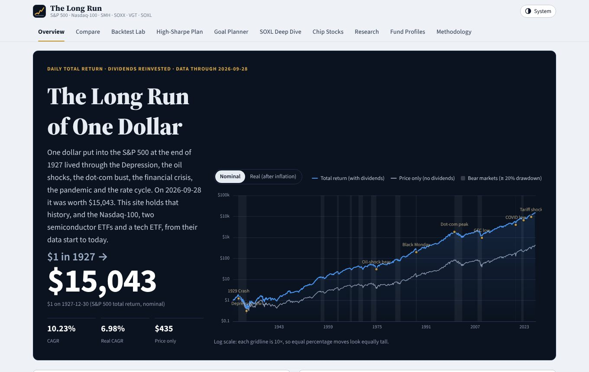
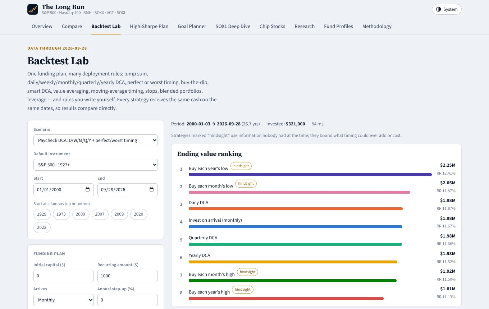
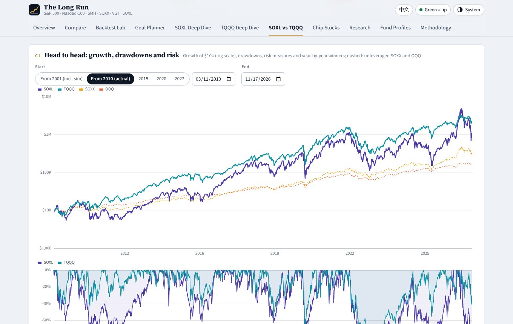

# The Long Run

**A century of market data and backtests, computed live in your browser.**

The Long Run is a static research site about long-term investing in US equities, the Nasdaq-100 and semiconductors. It starts from one dollar put into the S&P 500 at the end of 1927 and follows it through every crash since, then lets you compare instruments, backtest more than 30 investment rules, study the 3× ETFs SOXL and TQQQ in depth and plan towards a savings goal. Every number on the site is recomputed in the browser from daily data (1927-12-30 to the latest close, plus the current session while the market is open); nothing is pre-rendered.

The site opens in English; the **中文** button in the header switches it to Chinese (and back), and a separate button switches the up/down colors between green-up (US) and red-up (China). Both choices are remembered in the browser.



## What's inside

| Tab | What it does |
| --- | --- |
| **Overview** | $1 in the S&P 500 since 1927 (total return, nominal or real), cards for each instrument, six data-driven findings, a market snapshot computed from the latest data (with hand-kept forward P/Es and the Fed funds rate) and a 2025–26 timeline. |
| **Bull/Bear** (experimental) | Where the S&P 500, the Nasdaq-100 and semiconductors stand and what followed similar states, without forecasting tops or bottoms: each index's phase (bull, trend weakening, at the bull/bear boundary, bear, new bull) and how far past falls of the same depth went before they ended — all of them, without and with a recession, and grouped by the alerts lit at the time — with the conditions that would change the read and item-by-item signs of a top and of panic; each index's fall from its high and bear-market template (T0 correction, T1 valuation or policy, T2 semiconductor downturn, T3 recession and credit); five structural-bear alerts (unemployment, jobless claims, credit spreads, financial conditions, a yield curve inverted within 18 months); a leverage dial for TQQQ and SOXL (3×, 2×, 1× or T-bills from the index's 20-day volatility, capped by the alerts) with the break-even volatility, Kelly leverage and six rules backtested since 1985 (TQQQ\*) and 1994 (SOXL\*); 23 indicators in six layers, each with its history (NBER recessions shaded) and what followed the days it was on, with block-bootstrap intervals; every bear market of the three indices and what followed the first 20% fall; keep 3×, switch to 1× or hold T-bills for a fund already held (at a typed-in price); the semiconductor sales cycle (WSTS); and a hand-kept watchlist (forward P/Es, sentiment, memory prices, AI capex). |
| **Compare** | Any mix of S&P 500, Nasdaq-100 (QQQ), SMH, SOXX, VGT, SPY, SOXL, TLT/IEF/GLD and ten chip stocks over any window: growth, drawdowns, rolling returns and volatility, relative strength, 24 risk/return statistics, calendar and monthly heatmaps, correlation matrix, drawdown episodes. |
| **Backtest Lab** | One funding plan, up to eight strategies side by side: lump sum, DCA at any cadence, staged entry, buy-the-dip and dip ladders, smart DCA, value averaging, moving-average and golden-cross timing, trailing stops, volatility targeting, RSI mean reversion, Donchian breakouts, seasonality, grids, take-profit, absolute momentum, custom rule sets, combos of rules, leverage, and multi-asset rotation / risk parity / minimum variance / max-Sharpe portfolios. Includes an in-sample/out-of-sample check with the probability of backtest overfitting, a dip analysis, rolling-start robustness tests and a Monte Carlo of future paths. |
| **Goal Planner** | The chance of reaching a savings target by holding SPY or QQQ; the monthly saving needed for 50/75/90% confidence; safe withdrawal rates afterwards. USD or CNY, nominal or real. |
| **SOXL Deep Dive** | What "3×" really delivers: a calibrated simulation back to 2001, year-by-year decay, holding-period odds, the growth-optimal leverage, drawdowns, what came after a fall from the high under any combination of conditions (the fall, the rebound from the low, VIX or volatility, the trend, the broad market; measured on SOXL or SOXX) with mean, median and any percentiles over horizons you choose (from one trading day to 30 years), the worst fall while holding, SOXX on the same days and a side-by-side comparison of combinations, and eight ways to hold it. |
| **TQQQ Deep Dive** | The same eight studies for the 3× Nasdaq-100 fund, with a simulation on QQQ back to 1999 (through the dot-com bust). In both deep dives the whole history, the holding-period odds, the leverage study and the eight approaches each take their own start and end dates. |
| **SOXL vs TQQQ** | The two 3× funds side by side, each section with its own dates: today's signal for every rule on the page; growth, drawdowns, risk and year-by-year winners; holding periods and entry dates; mixes with rebalancing, rolling correlation and relative strength; returns after big falls under the same combined conditions (fall, rebound, fear, trend, market), each fund on its own days or both on one fund's days, with a comparison of combinations and an out-of-sample check; a plan — a first amount plus regular purchases, optionally boosted when C4's conditions hold — under one of six ways of holding, as one backtest from your start to your end (with the time below the money put in), as the spread of results from every start date (any start can be loaded into the backtest), and with all six ways side by side; and when to sell: ten selling rules plus the hindsight best for the same purchases over the same period, ranked by the geometric mean with a cluster-bootstrap 90% interval for each difference from holding, the money after a sale in T-bills or the 1× index, the rules decade by decade (2000–09 including the simulated years, since 2010, and three bear markets) with a chart of what each costs in good years against what it saves in bad ones, every take-profit, stop-loss and trailing-stop level and a take-profit × stop-loss heat map. Every rule is explained on hover and in full. |
| **Chip Stocks** | Micron, Western Digital, Seagate, Nvidia, AMD, Broadcom, Intel, Applied Materials, Lam Research and KLA: memory-cycle depth and recovery times, forward returns after big falls, correlations, where each stands today. |
| **Research** | Seventeen studies: holding periods, missing the best days, the value of market timing, lump sum vs staging, buying after drawdowns, seasonality, leverage decay, the semiconductor cycle, crisis recoveries, dividends and inflation, inflation regimes since 1973, decades, VIX, CAPE, concentration, the Nasdaq-100 since 1985 and the literature. |
| **Fund Profiles** | Index methodology, fees, assets, holdings and structure of each fund, with this site's returns checked against the issuers' official figures. |
| **Methodology** | Data health (how current each series is, the latest update runs and their warnings), data sources, how each series is built, validation results, metric definitions, backtest assumptions and limitations. |

<p>


</p>

## How the numbers are built

- **Total return everywhere.** ETF series compound raw closes and per-share dividends; the S&P 500 is rebuilt from the daily price index plus Shiller dividends (SPY-implied yield after mid-2023). Against S&P Dow Jones Indices' official annual total returns (1988–2025) the mean gap is 0.08 percentage points a year.
- **No look-ahead.** Price signals use the previous close and trade at today's close by default; cash earns the T-bill rate; costs are charged per trade. A test rewrites every price after a cut-off date and checks that 26 strategies produce identical results up to that date (strategies that use hindsight on purpose are labelled as such and are excluded from rankings).
- **Validated against published studies.** The test suite reproduces J.P. Morgan's "missing the best days" (11.0% → 6.6%, 2006–2025), Vanguard's lump-sum win rate (two-thirds), Schwab's market-timing study (2005–2024, within 6%) and the issuers' 1/3/5/10-year returns for SMH and SOXX (within 0.1 pp).
- **Honest about overfitting.** The Lab's in-sample/out-of-sample check reports the probability of backtest overfitting, and the leveraged-ETF studies report the number of separate falls behind every conditional result, not just the number of days.

Full details are on the Methodology tab.

## Data

| Series | Coverage | Source |
| --- | --- | --- |
| S&P 500 price index (daily) | 1927-12-30 → present | Yahoo Finance ^GSPC via public GitHub datasets |
| S&P 500 dividends (monthly) | 1928 → 2023-06, then SPY-implied | Robert Shiller via datahub.io |
| SPY, QQQ, SOXX, TLT, IEF, GLD | from 1995 / 1999 / 2001 / 2002 / 2004 | Yahoo closes + dividends + splits (Johnbrick123/sp500-data) |
| SMH, VGT | from 2006-09-29 | yfinance adjusted closes (public cache) |
| SOXL, TQQQ | from 2010 (simulated from 2001 / 1999) | Yahoo full-precision closes + distributions; before launch SOXL\* = 3× the PHLX Semiconductor index, TQQQ\* = 3× QQQ, calibrated on the real funds ([`scripts/rebuild-leveraged.js`](scripts/rebuild-leveraged.js)) |
| Opening prices of SOXL, TQQQ, SOXX, QQQ | from 2010 | Yahoo split-adjusted opens, kept as each session's move from the previous close to its open (S6's check of judging and buying at the next open) |
| Ten chip stocks | mostly from 1995 | Yahoo closes + dividends + splits |
| T-bills · CPI-U · VIX | 1928+ · 1913+ · 1990+ | Ken French, FRED DTB3, then the U.S. Treasury · BLS · CBOE, then Yahoo |
| 10-year yield · gold · USD/CNY (long-run and currency views) | 1953+ · 1960+ · 1981+ | FRED GS10, then the U.S. Treasury · World Bank · FRED H.10, then Yahoo |

All data is embedded in [`data/market-data.js`](data/market-data.js) in a compact delta encoding and decoded by [`assets/js/core.js`](assets/js/core.js).

The Bull/Bear tab adds its own series in [`data/regime-data.js`](data/regime-data.js), built by [`scripts/update-regime.js`](scripts/update-regime.js) (no API keys):

| Series | Coverage | Source |
| --- | --- | --- |
| Nasdaq-100 and PHLX Semiconductor price indices | 1985-10 / 1994-05 → present | Yahoo Finance ^NDX, ^SOX (they extend TQQQ\* and SOXL\* before QQQ and SOXX) |
| VIX3M · HYG · RSP · QQEW · XSD (total return) | 2007 · 2007 · 2003 · 2006 · 2006 → present | Yahoo Finance |
| Treasury yields: 3-month, 1-, 2-year; 10-year real | 1990+ (real 2003+), monthly averages | U.S. Treasury |
| Unemployment rate · initial jobless claims (not seasonally adjusted, summed over the states) | 1948+ · 1986+ | BLS · Department of Labor (ETA 539) |
| GZ credit spread, excess bond premium and its recession probability | 1973+ | Federal Reserve Board |
| NFCI / ANFCI | 1971+ | Chicago Fed (the public file stops at 2026-04-24; until it resumes, the alert counts as "no data") |
| Worldwide semiconductor sales (single months and three-month averages) | 1986+ | WSTS Historical Billings Report |
| Shiller CAPE after the site's own series ends | 2023-10+ | multpl.com |

Monthly and weekly series are used only from the day they were published (each has a publication lag), so the tab's statistics do not look ahead; revised series (unemployment, credit spreads, NFCI) are today's vintages. Figures that cannot be downloaded (forward P/Es, sentiment surveys, memory prices, company figures, the Fed funds target) are kept by hand in [`data/manual.js`](data/manual.js), each with its date, source and whether it has been checked.

## Daily data updates

After every US market close (23:17 UTC: 19:17 in New York in summer, 18:17 in winter) and again before the next open (11:17 UTC, to catch up anything the evening run missed), the [Update market data](.github/workflows/update-data.yml) workflow:

1. downloads the new sessions from Yahoo Finance (the S&P 500, VIX, USD/CNY and every ETF and stock: closes, dividends, splits, and the opens of SOXL, TQQQ, SOXX and QQQ), the U.S. Treasury (T-bill rate, 10-year yield) and the BLS (CPI). FRED refuses connections from GitHub's servers;
2. recomputes the last 20 stored sessions of every series from the new download and stops if they disagree;
3. appends the new sessions to `data/market-data.js` and rebuilds values that were provisional (the latest T-bill rate and exchange rate, the S&P 500 dividend of the current month);
4. updates the Bull/Bear tab's series (`node scripts/update-regime.js`; best effort, so a source that is down never holds up the market data: it keeps its stored series and the tab lists it) and, on `main`, compares the tab's state with the previous update's ([`scripts/regime-alert.js`](scripts/regime-alert.js), `data/regime-state.json`);
5. runs the unit tests and the browser smoke test on the result, commits it to `main` and redeploys the site. If the Bull/Bear state changed — the number of structural-bear alerts, a template moving into or out of T1–T3, or a leverage gear for TQQQ or SOXL — it opens an issue labelled `regime-alert` (mentioning the owner, so GitHub sends an e-mail) and closes the previous one.

A session counts once it is 18:00 in New York, two hours after the close. If any step fails, nothing is committed and the site keeps the previous data. A failed scheduled or manual run opens an issue labelled `data-update-failure` (mentioning the repository owner, so GitHub sends an e-mail) or adds the failure to the one already open, quoting the failing step's log; the next successful run closes it. Independently, every page shows a red banner once a session is missing from the data at 20:00 New York time the next day, and the Methodology tab's *Data health* card lists each series' last date, the last eight update runs and the warnings of the latest data commits (read from GitHub's public API in the visitor's browser). To run it by hand: **Actions → Update market data → Run workflow** (tick *check only* to download and verify without committing). Locally: `node scripts/update-data.js --check`.

### Intraday prices

While the market is open, the [Pages deployment](.github/workflows/pages.yml) runs every 30 minutes (13:07–21:37 UTC on weekdays) and adds the session that is still trading to the deployed copy of the data with `node scripts/update-data.js --live --out _site/data/market-data.js`. That session is provisional: its prices are Yahoo's latest quotes, the T-bill rate and exchange rate are carried forward, and a banner on every tab gives the time of the prices ("Intraday data: prices for … are as of 13:45 New York time"). After the close it is labelled a preliminary close until the evening update commits the official data and redeploys. Provisional prices are never committed: `--live` refuses to write into `data/market-data.js`, and the updater refuses to build on a file that contains them. A scheduled run that finds nothing newer than the committed data (before the open, on holidays, or when Yahoo cannot be reached) leaves the deployed site as it is.

Not updated automatically: hand-written facts (fund profiles, the parts of the market snapshot kept by hand, the timeline, the Bull/Bear watchlist in `data/manual.js`) and the long-run CAPE and World Bank gold histories. Each carries its date, and the Bull/Bear tab greys out a figure once it is older than its stated shelf life.

## Running it

The site has no build step and no runtime dependencies (ECharts is bundled in `assets/vendor`).

```sh
# open index.html directly, or serve the folder:
npm run serve            # http://127.0.0.1:8080/

npm test                 # unit tests: data, calendar, metrics, engine, no-look-ahead, replications, data updaters, Bull/Bear
npx playwright install chromium && npm run test:e2e   # renders every tab in a headless browser
```

## Publishing on GitHub Pages

1. In the repository go to **Settings → Pages** and set **Source** to **GitHub Actions**.
2. Merge into `main`. The [Pages workflow](.github/workflows/pages.yml) runs the unit tests and, if they pass, publishes `index.html`, `assets/` and `data/` to `https://oscarzhang-research.github.io/Backtest-website/`.
3. The same workflow also publishes the branch under review (`BETA_REF` in the workflow) as a preview at `/beta/`, on a best-effort basis; a bar at the top of the preview says so. The preview shares the browser storage of the live site.

Every push and pull request also runs the [CI workflow](.github/workflows/ci.yml) (unit tests plus the browser smoke test).

## Project layout

```
index.html               page shell: header, tabs, view containers
assets/css/site.css      design tokens (light/dark), layout, components
assets/js/i18n.js        UI strings in English and Chinese, and the t()/L() helpers
assets/js/core.js        data decoding, calendar, total-return series, metrics
assets/js/engine.js      backtest engine: funding plans, 30+ rules, multi-asset runner, XIRR, Monte Carlo
assets/js/calc.js        research statistics (holding periods, best days, PBO, selling rules, ...)
assets/js/lr.js          monthly 1971–today data and inflation regimes (Research R11)
assets/js/regime.js      Bull/Bear: indicators, alerts, templates, bear markets, conditional statistics, the leverage dial
assets/js/facts.js       sourced fund facts, market snapshot, timeline, literature
assets/js/ui.js, app.js  DOM and chart helpers, routing, theme
assets/js/views/*.js     one module per tab
data/market-data.js      embedded market data
data/regime-data.js      Bull/Bear series (scripts/update-regime.js; scripts/regime/: sources, builder, a minimal .xlsx reader)
data/manual.js           hand-kept figures for the Bull/Bear watchlist and the market snapshot
scripts/update-data.js   daily data update and intraday prices (scripts/data/: download, verify, append)
scripts/regime-alert.js  the Bull/Bear state after an update, compared with data/regime-state.json
tests/                   node:test suites and the Playwright smoke test
```

## Roadmap

What was added most recently and what could come next (a live track record, costs and taxes, inflation-resistant assets, withdrawal rules): see [docs/ROADMAP.md](docs/ROADMAP.md).

## Disclaimer

For research and education only; this is not investment advice. Backtests describe the past under simplifying assumptions (no taxes, idealised execution) and do not predict future returns. Real-world ETF returns also depend on taxes, spreads and tracking error.

Charts by [Apache ECharts](https://echarts.apache.org/) (Apache License 2.0).
