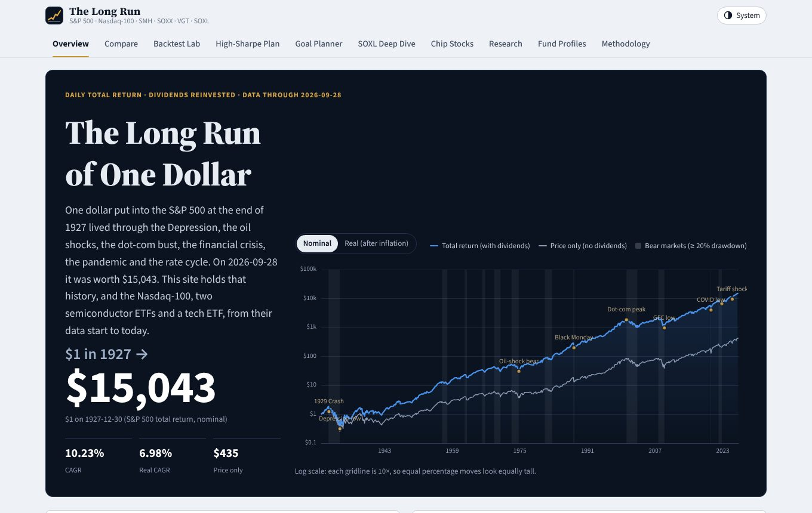
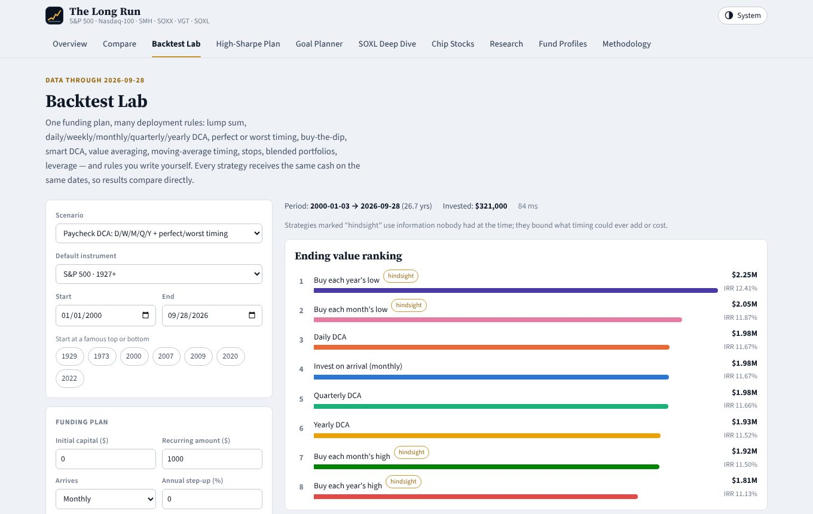
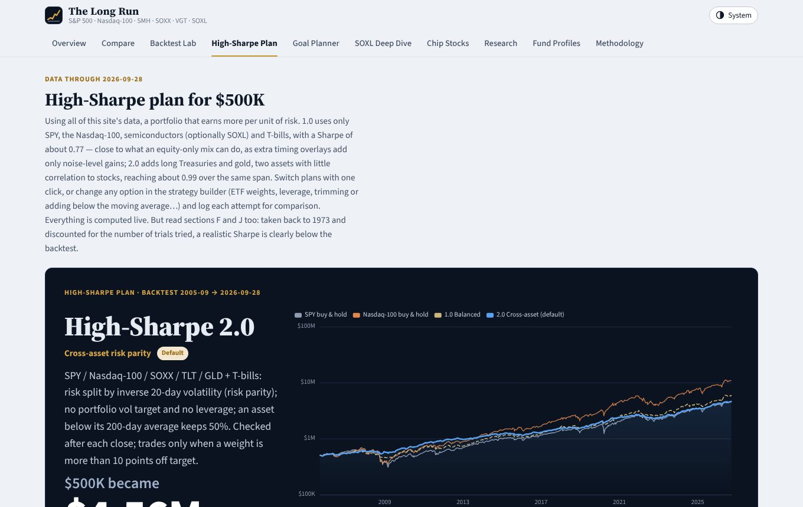

# The Long Run

**A century of market data and backtests, computed live in your browser.**

The Long Run is a static research site about long-term investing in US equities, the Nasdaq-100 and semiconductors. It starts from one dollar put into the S&P 500 at the end of 1927 and follows it through every crash since, then lets you compare instruments, backtest more than 30 investment rules, stress-test a cross-asset "High-Sharpe" portfolio and plan towards a savings goal. Every number on the site is recomputed in the browser from daily data (1927-12-30 → 2026-09-28); nothing is pre-rendered.



## What's inside

| Tab | What it does |
| --- | --- |
| **Overview** | $1 in the S&P 500 since 1927 (total return, nominal or real), cards for each instrument, six data-driven findings, a September 2026 market snapshot and a 2025–26 timeline. |
| **Compare** | Any mix of S&P 500, Nasdaq-100 (QQQ), SMH, SOXX, VGT, SPY, SOXL, TLT/IEF/GLD and ten chip stocks over any window: growth, drawdowns, rolling returns and volatility, relative strength, 24 risk/return statistics, calendar and monthly heatmaps, correlation matrix, drawdown episodes. |
| **Backtest Lab** | One funding plan, up to eight strategies side by side: lump sum, DCA at any cadence, staged entry, buy-the-dip and dip ladders, smart DCA, value averaging, moving-average and golden-cross timing, trailing stops, volatility targeting, RSI mean reversion, Donchian breakouts, seasonality, grids, take-profit, absolute momentum, custom rule sets, combos of rules, leverage, and multi-asset rotation / risk parity / minimum variance / max-Sharpe portfolios. Includes an in-sample/out-of-sample check with the probability of backtest overfitting, a dip analysis, rolling-start robustness tests and a Monte Carlo of future paths. |
| **High-Sharpe Plan** | A cross-asset portfolio (SPY, QQQ, SOXX, long Treasuries, gold) built with inverse-volatility weights and a 200-day trend filter, with a full strategy builder, today's target allocation, parameter plateaus, walk-forward tests, a 1929–2026 equity test, a 50-year monthly stress test, crisis tables, a 32-strategy tournament and an overfitting check (deflated Sharpe, multiple-testing haircut, PBO). |
| **Goal Planner** | The chance of reaching a savings target with the High-Sharpe plans, SPY or QQQ; the monthly saving needed for 50/75/90% confidence; safe withdrawal rates afterwards. USD or CNY, nominal or real. |
| **SOXL Deep Dive** | What "3×" really delivers: a calibrated simulation back to 2001, year-by-year decay, holding-period odds, the growth-optimal leverage, drawdowns and eight ways to hold it. |
| **Chip Stocks** | Micron, Western Digital, Seagate, Nvidia, AMD, Broadcom, Intel, Applied Materials, Lam Research and KLA: memory-cycle depth and recovery times, forward returns after big falls, correlations, where each stands today. |
| **Research** | Sixteen studies: holding periods, missing the best days, the value of market timing, lump sum vs staging, buying after drawdowns, seasonality, leverage decay, the semiconductor cycle, crisis recoveries, dividends and inflation, decades, VIX, CAPE, concentration, the Nasdaq-100 since 1985 and the literature. |
| **Fund Profiles** | Index methodology, fees, assets, holdings and structure of each fund, with this site's returns checked against the issuers' official figures. |
| **Methodology** | Data sources, how each series is built, validation results, metric definitions, backtest assumptions, how the High-Sharpe plan was chosen, and limitations. |

<p>


</p>

## How the numbers are built

- **Total return everywhere.** ETF series compound raw closes and per-share dividends; the S&P 500 is rebuilt from the daily price index plus Shiller dividends (SPY-implied yield after mid-2023). Against S&P Dow Jones Indices' official annual total returns (1988–2025) the mean gap is 0.08 percentage points a year.
- **No look-ahead.** Price signals use the previous close and trade at today's close by default; cash earns the T-bill rate; costs are charged per trade. A test rewrites every price after a cut-off date and checks that 26 strategies produce identical results up to that date (strategies that use hindsight on purpose are labelled as such and are excluded from rankings).
- **Validated against published studies.** The test suite reproduces J.P. Morgan's "missing the best days" (11.0% → 6.6%, 2006–2025), Vanguard's lump-sum win rate (two-thirds), Schwab's market-timing study (2005–2024, within 6%) and the issuers' 1/3/5/10-year returns for SMH and SOXX (within 0.1 pp).
- **Honest about overfitting.** The High-Sharpe page discounts its own backtest for the number of variants tried and replays the rules over 1973–2026 on data never used in research.

Full details are on the Methodology tab.

## Data

| Series | Coverage | Source |
| --- | --- | --- |
| S&P 500 price index (daily) | 1927-12-30 → 2026-09-28 | Yahoo Finance ^GSPC via public GitHub datasets |
| S&P 500 dividends (monthly) | 1928 → 2023-06, then SPY-implied | Robert Shiller via datahub.io |
| SPY, QQQ, SOXX, TLT, IEF, GLD | from 1995 / 1999 / 2001 / 2002 / 2004 | Yahoo closes + dividends + splits (Johnbrick123/sp500-data) |
| SMH, VGT | from 2006-09-29 | yfinance adjusted closes (public cache) |
| SOXL, TQQQ | from 2010 | split-adjusted closes; SOXL simulated from SOXX before 2010 |
| Ten chip stocks | mostly from 1995 | Yahoo closes + dividends + splits |
| T-bills · CPI-U · VIX | 1928+ · 1913+ · 1990+ | Ken French and FRED DTB3 · BLS · CBOE |
| 10-year yield · gold · USD/CNY (long-run and currency views) | 1953+ · 1960+ · 1981+ | FRED GS10 · World Bank · FRED H.10 |

All data is embedded in [`data/market-data.js`](data/market-data.js) in a compact delta encoding and decoded by [`assets/js/core.js`](assets/js/core.js).

## Running it

The site has no build step and no runtime dependencies (ECharts is bundled in `assets/vendor`).

```sh
# open index.html directly, or serve the folder:
npm run serve            # http://127.0.0.1:8080/

npm test                 # 40 unit tests: data, metrics, engine, no-look-ahead, replications
npx playwright install chromium && npm run test:e2e   # renders every tab in a headless browser
```

## Publishing on GitHub Pages

1. In the repository go to **Settings → Pages** and set **Source** to **GitHub Actions**.
2. Merge into `main`. The [Pages workflow](.github/workflows/pages.yml) runs the unit tests and, if they pass, publishes `index.html`, `assets/` and `data/` to `https://oscarzhang-research.github.io/Backtest-website/`.

Every push and pull request also runs the [CI workflow](.github/workflows/ci.yml) (unit tests plus the browser smoke test).

## Project layout

```
index.html               page shell: header, tabs, view containers
assets/css/site.css      design tokens (light/dark), layout, components
assets/js/i18n.js        UI strings and the t()/L() helpers
assets/js/core.js        data decoding, calendar, total-return series, metrics
assets/js/engine.js      backtest engine: funding plans, 30+ rules, multi-asset runner, XIRR, Monte Carlo
assets/js/calc.js        research statistics (holding periods, best days, PSR/DSR/PBO, ...)
assets/js/lr.js          monthly 1971–today engine for the 50-year stress test
assets/js/facts.js       sourced fund facts, market snapshot, timeline, literature
assets/js/ui.js, app.js  DOM and chart helpers, routing, theme
assets/js/views/*.js     one module per tab
data/market-data.js      embedded market data
tests/                   node:test suites and the Playwright smoke test
```

## Disclaimer

For research and education only; this is not investment advice. Backtests describe the past under simplifying assumptions (no taxes, idealised execution) and do not predict future returns. Real-world ETF returns also depend on taxes, spreads and tracking error.

Charts by [Apache ECharts](https://echarts.apache.org/) (Apache License 2.0).
